# Modelo de datos — Cliente y Artículo (cruce pantallas ↔ base)

Fuente: `C:\administraNET\Bases\estructura_default_adm.sql` (MySQL 5.7, base `administranet`, InnoDB, utf8) cruzado con [MAESTROS_CLIENTE_ARTICULO.md](MAESTROS_CLIENTE_ARTICULO.md). Los nombres de tabla/columna son los reales de la base. Los valores de ejemplo salen de los `INSERT` de semilla del propio dump.

## 1. Diagrama

```mermaid
erDiagram
  cliente ||--o{ cliente_domicilio : "id_cliente"
  cliente ||--o{ cliente_contacto : "id_cliente"
  cliente ||--o| clientes_web : "Codigo"
  cliente ||--o| sp_saldo_cliente_premios : "id_cliente"
  cliente }o--|| tipo_cliente : "TipoCliente"
  cliente }o--|| contribuyentes : "IDIva"
  cliente }o--|| cond_venta : "id_cv"
  cliente }o--|| viajantes : "CodViajante / id_cobrador"
  cliente }o--|| erp_zona : "id_zona"
  cliente }o--|| provincia : "CodProvincia"
  cliente }o--|| departamento : "IDDepartamento"
  cliente }o--|| distrito : "IDDistrito"
  cliente }o--|| pais : "id_pais"
  cliente }o--|| sucursales : "id_sucursal"
  cliente }o--o| crm_categoria : "id_categoria"
  cliente }o--|| cont_pc : "id_pc"
  provincia ||--o{ departamento : "CodProvincia"
  departamento ||--o{ distrito : "IDDepartamento"
  articulo }o--|| rubro : "CodigoRubro"
  articulo }o--|| subrubro : "IDSubRubro"
  rubro }o--|| rubro_categoria : "id_categoria"
  articulo }o--|| marca : "CodigoMarca"
  articulo }o--|| modelo : "CodigoModelo"
  articulo }o--|| unidmed : "id_unimed"
  articulo }o--|| presentacion_abm : "id_presentacionV"
  articulo }o--|| iva : "Alicuota / AlicuotaC"
  articulo }o--|| activ_iibb : "AlicuotaIB"
  articulo }o--|| impuesto_interno_abm : "id_impuesto_interno_abm"
  articulo }o--|| descuento_proveedor : "id_descuento_proveedor"
  articulo }o--|| cotizacion : "id_cotizacion"
  articulo }o--|| cont_pc : "id_pc_vta / id_pc_comp"
  articulo ||--o{ articulo_prov : "IDArt"
  articulo ||--o{ articulo_precio_prov : "id_articulo"
  articulo ||--o{ articulo_costo_adicional : "IDArt"
  articulo ||--o{ articulo_foto : "idArt"
  articulo ||--o{ articulo_promo_intervalo : "id_articulo"
  articulo ||--o{ articulo_tipo_cliente : "id_articulo"
  articulo ||--o{ articulo_val_ce : "id_articulo"
  articulo_ce ||--o{ articulo_val_ce : "id_articulo_ce"
  articulo ||--o{ stock_deposito : "id_articulo"
  deposito ||--o{ stock_deposito : "id_deposito"
  articulo ||--o{ stock : "IDArt (libro de movimientos)"
  articulo ||--o{ lote : "id_articulo"
  lote ||--o{ lote_stock : "id_lote"
  articulo ||--o{ precios_historial : "id_articulo"
```

## 2. Cliente — pantalla → columna

Tabla principal `cliente` (PK `Codigo` int autoincrement). Semilla: 1 = "Consumidor Final" (código manual `CF`, doc `NOID`, IVA 4) y 2 = "Cliente 1" (de ejemplo).

| Pantalla | Columna / tabla | Notas |
|---|---|---|
| Código Sistema | `cliente.Codigo` | |
| Código Manual | `id_manual_cli` | `nro_codigo_manual_cliente` + `configuracion.nro_automatica_cod_cliente_manual` generan la numeración automática |
| Ingreso | `FechaAlta` (timestamp) | |
| Tipo | `TipoCliente` → `tipo_cliente` | 1 Común, 2 Minorista, 3 Mayorista, 4 Distribuidor, 5 Especial |
| Nombre / Nombre fantasía | `nombre_cliente` (200), `nombre_fantasia` (300) | |
| Sucursal | `id_sucursal` → `sucursales` | |
| Observaciones | `Observaciones` | |
| Calle / Número / Dpto | `Calle`, `NroCalle`, `Dpto` | el domicilio principal vive en `cliente`; los adicionales en `cliente_domicilio` |
| País / Provincia / Localidad / Distrito | `id_pais`, `CodProvincia`, `IDDepartamento`, `IDDistrito` | jerarquía `provincia → departamento (= localidad, con cod_postal) → distrito` |
| Zona | `id_zona` → `erp_zona` | zona pertenece a país+provincia |
| Teléfono / Fax / E-mail / WhatsApp / Web | `telefono`, `Fax`, `Email`, `whatsapp_empresa`, `web_empresa` | |
| Contacto (nombre, teléfono, celular, e-mail) | `NombreContacto`, `TelefonoContacto`, `CelularContacto`, `EmailContacto` | contacto principal; más contactos en `cliente_contacto` |
| Descuentos Pie / Renglón | `Descuento` (pie), `descuento_por_cli` (renglón) | |
| Vendedor / Cobrador | `CodViajante`, `id_cobrador` → `viajantes` | una sola tabla; flag `viajantes.cobrador='Si'` marca quién cobra. Semilla: 1 "-Ninguno-", 2 y 3 vendedores con 5 % de comisión |
| Lista de Precios | `ListaPrecio` varchar(60) (ej. `Lista 1`) | **no es FK**: guarda el texto. Los rótulos de las 5 listas están en `configuracion.desc_util1..5` y la marcación por defecto en `valor_util1..5` (25/30/35/40/45) |
| Cond Venta | `id_cv` → `cond_venta` | tabla con `Dias`, `tipo_cv` (Normal / Cta Cte), `descuento`, `interes`, `tipo_cond_elect` (Mercado Pago). Semilla: Contado, Tarjeta, Cheque, Cta/Cte 7 a 180 días |
| Estado | `Estado` varchar(30) | `Activo` / `No Activo` |
| IVA | `IDIva` → **`contribuyentes`** (no `iva`) | ver nota 1 |
| Tipo Doc / número | `tipo_doc`, `CUIT` (varchar 20, default `00-00000000-0`) | el mismo campo guarda CUIT o DNI según `tipo_doc` |
| Nro Ingresos Brutos / Agente Retención | `NroIngBrutos`, `NroAgenteRetencion` | |
| Cuenta Contable | `id_pc` → `cont_pc` (default 13 = Deudores por Ventas 110301) | |
| Crédito: cupo | `Credito` | |
| Crédito: límite vencimiento días / en cheques / cheques de terceros | `credito_limite_dias`, `credito_cheque`, `credito_cheque_tercero` | |
| Crédito: "valores actuales" (solo lectura) | calculado desde `cuentacliente` | no se guarda en `cliente` |
| Saldo (columna del listado) | `saldo` (cacheado) | se mantiene desde cobranzas/ventas; `fecha_ultima_compra` también |
| Avisos: texto / habilita | `aviso`, `habilita_aviso` | |
| CRM: Categoría | `id_categoria` → `crm_categoria` | |
| Ecommerce: activa | `cliente_ecommerce` | |
| Ecommerce: usuario / contraseña | `clientes_web` (`codigo_usuario`, `clave_usuario` blob, `activo_usuario`, `clave_usuario_temporal`, login social `oath_proveedor`, `token`) | |
| SP: habilita puntaje | `habilita_sp` + saldo en `sp_saldo_cliente_premios` (`saldo_premios`, `vencimiento`) | parámetros globales en `configuracion.activ_sp`, `nombre_sp` |
| PD: habilita descuentos | `habilita_pd` | parámetros: `configuracion.activ_pd`, `nombre_pd` |
| Domicilios (grilla) | `cliente_domicilio` | además de dirección: geo_latitud/longitud, hora_desde/hasta, `periodicidad_visita_vendedor`, datos de envío de ecommerce (`*_ecom`) |
| Contactos (grilla) | `cliente_contacto` | `nombre_cliente_contacto`, `tipo_doc`, `nro_doc`, teléfono, celular, e-mail, `whatsapp`, `diasContacto`, `anulado` |
| (no está en pantalla de alta) | `cliente_datos_adicionales` | datos de entrega por comprobante: depósito despacho, forma de entrega, transporte, repartidor, ruta, operador logístico, nro seguimiento |

**Nota 1 — IVA del cliente.** Pese al nombre, `cliente.IDIva` no apunta a la tabla `iva` (que son alícuotas: 21 %, 10,5 %, 27 %, Exento, No gravado) sino a **`contribuyentes`** (`IDIva`, `IVA`, `Abreviado`, `cod_afip`), la condición frente al IVA: 1 Responsable Inscripto (RI, AFIP 1), 2 Monotributista (MON, 6), 3 Exento (EX, 4), 4 Consumidor Final (CF, 5), 5 Exportación (EXPO, 9), 6 Responsable Inscripto M (RIM, 1), 7 Responsable Inscripto CBU (RICBU, 1), 8 IVA no alcanzado (IVANO, 15). Coincide con los valores de la semilla: Consumidor Final = 4, cliente de ejemplo = 1. El diagrama de la sección 1 y la tabla de catálogos deben leerse con esta corrección: la relación es `cliente }o--|| contribuyentes`.

## 3. Artículo — pantalla → columna

Tabla principal `articulo` (PK `IDArt` int autoincrement, ~140 columnas). Semilla: 1 "Articulo 1" (costo 100, marcación 20/30 %), 2 "Combustibles" (tipo Gasto), 3 "Servicio 1".

| Pantalla | Columna / tabla | Notas |
|---|---|---|
| Nombre | `NombreArticulo` | |
| Tipo | `tipo_art` | Artículo, Servicio, Bienes de uso, Materia prima; la semilla usa también `Gasto` (con `cod_gasto`) |
| Cod. Sist 1 / Cod. Sist 2 | `CodigoArticuloT` (`1.1.1` = rubro.subrubro.artículo), `CodigoArticulo` (numérico) | el código de sistema se compone con rubro y sub-rubro |
| Cod. Manual / Cod Prov | `id_manual`, `CodArtProv` | `configuracion.repite_cod_manual` controla si se permite repetir |
| Rubro / Sub-Rubro | `CodigoRubro` → `rubro`; `IDSubRubro` → `subrubro` (+ `CodigoSubRubro`, `CodigoSubRubroT`) | `rubro.tipo_rubro`, `rubro.id_categoria` → `rubro_categoria`, flags de ecommerce y foto |
| Proveedor / Marca / Modelo | `CodigoProveedor`, `CodigoMarca` → `marca`, `CodigoModelo` → `modelo` | modelo pertenece a una marca; `CodLaboratorio` → `laboratorio` (rubro farmacia, no está en pantalla) |
| Detalle | `Detalle`; web: `detalle_web` | |
| IVA Venta / IVA Compra | `Alicuota` y `AlicuotaC` → `iva` (+ `TipoIVA` texto: Gravado) | 1: 21 %, 2: 10,5 %, 3: 27 %, 4: Exento, 5: No gravado; `iva.cod_afip` 5/4/6/2/1 |
| IIBB | `AlicuotaIB` → `activ_iibb` (+ `TipoIB`, `cod_act_iibb`) | 1 Exento 0 % (inactiva), 2 Bienes de Cambio 3,5 %, 3 Fabricación 1 % |
| Impuesto interno | `id_impuesto_interno_abm` → `impuesto_interno_abm` (+ `impuesto_interno`) | tipo Porcentaje / Peso / Monto fijo, `pago_minimo` |
| Moneda | `Moneda` (Pesos / Dólar) + `id_cotizacion` → `cotizacion` | `cotizacion.defecto`, `ValorPesos`; `configuracion.cotizacion_moneda_tipo` (Defecto / Artículo) |
| Desc. prov | `id_descuento_proveedor` → `descuento_proveedor` | `composicion_descuento` guarda los porcentajes en cadena separados por `;` |
| Cont. Venta / Cont. Compra | `id_pc_vta` (111) y `id_pc_comp` (22) → `cont_pc` | |
| Disp venta / Disp comp | `disponible_vta`, `disponible_comp` | |
| Anulado | `Discontinuo` | |
| Comp. interno | `comprobante_interno` | |
| Lote / Serie | `lote`, `serie` | detalle en `lote` (`cod_lote`, `fecha_vto_lote`, `stock_total_lote`, proveedor) y `lote_stock` (stock por depósito) |
| Unidad med / Presentación | `id_unimed` → `unidmed`; `id_presentacionV` → `presentacion_abm` | unidades: Unidad, Metro, Kilogramo, Litro, Milímetro, Centímetro, Cajas, Horas, Gramos; presentaciones: Caja, Bolsa, Unidad |
| Pres venta | `multiplicador_vta` | |
| Límite de Vta | `limVtaxArt` | |
| Peso promedio | `cantidad_promedio_bulto` | |
| Nro. despacho | `nro_despacho` | |
| E-commerce / Destacado lista | `ecommerce`, `promo_destacado` | |
| Ensamblado | `ensamblado` + `id_en_abm` | módulo de ensamblaje aparte |
| Registro de precios de costo por proveedor | `articulo_precio_prov` (fecha, proveedor, `precio_costo`) | más `articulo_prov` (código y unidades por proveedor) |
| En promoción | `promocion` + `promocion_*` (por, cant, alcance, tipo, vigencia desde/hasta, listas 1–5) y `articulo_promo_intervalo` | alcance: Artículo, Rubro, Sub Rubro, Proveedor, Marca, Modelo |
| Campos adicionales (10 libres) | `articulo_ce` (definición de campo: caption y tipo Lista/Texto), `articulo_val_ce` (valor por artículo), `articulo_lista_valor_ce` (opciones de las listas), `articulo_valor_ce` y `articulo_caption_ce` (tablas planas `valor1..10`, para reportes Crystal) | dos modelos coexisten: normalizado y plano |
| Fotos / Videos | `articulo_foto` (url interna/externa, archivo, `foto_principal`, `foto_base` blob) y `articulo.Foto1/Foto2` (blobs heredados) | `configuracion.guarda_foto_base` decide si guarda la imagen en base |
| Código de Barra | `NroCodBarra` + `Simbologia` (interno), `NroCodBarraF` + `SimbologiaF` (proveedor/fábrica), `nro_cod_barra_bulto`, `nro_cod_barra_display`, imagen en `articulo_codbarra` | `configuracion.auto_genera_codbarra` lo arma con rubro y sub-rubro (semilla: `001001000001`) |
| Integración balanzas | `integracion_balanza` | SENASA: `fecha_elaboracion` en `stock`; parámetros `configuracion.tipo_balanza`, `codigo_plu` |

### Cadena de precios (campos reales)

| Pantalla | Columna |
|---|---|
| Costo neto directo → Precio de costo | `PrecioCosto` |
| Costo indirecto/adic. | `costo_adicional` + detalle en `articulo_costo_adicional` (Monto fijo o Porcentaje) |
| Costo dólar (+ check) | `costo_dolar`, `selec_costo_dolar` |
| % Desc. renglón / Bonificación / Desc. pie | `PorOficial1`, `PorOficial2`, `PorOficial3`; total en `UtilOficial` |
| Precio de costo bruto: costo / final | `PNOficial` (neto), `PFOficial` (final con IVA) |
| Recalcula precio de costo / de venta | `recalcula_pc`, `recalcula_pv` |
| Lista 1..5: % marcación | `Util1..Util5` |
| Lista 1..5: precio neto | `Precio1V..Precio5V` |
| Lista 1..5: precio final | `Precio1VI..Precio5VI` |

Verificación con la semilla (artículo 1): `PrecioCosto` 100, `Util1` 20 → `Precio1V` 120 → `Precio1VI` 145,2 (= 120 × 1,21); `Util2` 30 → 130 → 157,3. Las listas 3 a 5 tienen `Util` 0 y neto 100 (= costo). Los rótulos "Contado / Lista" vienen de `configuracion.desc_util*`. Los cambios de precio se registran en `precios_historial` (tipo: Individual, Masivo, Factura de Compra; modo de marcación: Actualiza, Reemplaza, Por Lista) y hay reglas masivas en `reglas_precio*`.

### Stock del artículo
- Saldo por depósito: `stock_deposito` (`id_articulo`, `id_deposito`, `saldo`, `saldo_pedido_cliente`, `saldo_pedido_proveedor`). Depósitos en `deposito` (semilla: "Depósito 1").
- Libro de movimientos: `stock` (una fila por renglón de comprobante, con entrada/salida, saldo, precios congelados, lote, serie, unidades). Es la tabla más ancha del sistema (~120 columnas) porque cada renglón de venta y compra queda aquí.
- `articulo.saldo_articulo` es el saldo cacheado; mínimo/máximo/punto de pedido: `stock_min`, `stock_max`, `punto_pedido`.

## 4. Catálogos que hay que sembrar (con valores reales)

| Tabla | Contenido de semilla |
|---|---|
| `tipo_cliente` | Común, Minorista, Mayorista, Distribuidor, Especial |
| `cond_venta` | Contado, Tarjeta, Cheque, Cta/Cte 7/15/30/60/90/120/150/180 |
| `iva` | alícuotas de artículo: 21 %, 10,5 %, 27 %, Exento, No gravado (+ código AFIP) |
| `contribuyentes` | condición de IVA del cliente: RI, Monotributista, Exento, Consumidor Final, Exportación, RI M, RI CBU, IVA no alcanzado |
| `activ_iibb` | Exento, Bienes de Cambio 3,5 %, Fabricación 1 % |
| `unidmed` | 9 unidades (Cantidad, Distancia, Peso, Volumen, Tiempo) |
| `presentacion_abm` | Caja, Bolsa, Unidad |
| `impuesto_interno_abm` | "Impuesto interno 0 %" |
| `viajantes` | -Ninguno-, Vendedor 1, Vendedor 2 |
| `erp_zona` | Zona 1, Zona 2 |
| `deposito` | Depósito 1 |
| `cotizacion`, `provincia`, `departamento`, `distrito`, `pais`, `rubro`, `subrubro`, `marca`, `modelo`, `cont_pc` | ver el dump (provincias y plan de cuentas vienen completos) |

## 5. Particularidades del esquema (decisiones para la réplica)

1. **Flags como texto:** los booleanos son `varchar(2)` con `'Si'`/`'No'` y los estados `'Activo'`/`'No Activo'`; `anulado` es la baja lógica casi en todas las tablas. En una réplica sobre la misma base hay que respetarlo; en una base nueva conviene `boolean`.
2. **Tipos de FK inconsistentes:** claves `int(11)`, `bigint`, `double(20,0)` y `decimal(15,0)` para el mismo concepto (p. ej. `id_cliente`, `id_articulo`). Casi no hay claves foráneas declaradas: la integridad la impone el programa VB6. Una réplica debe validar en la aplicación, o migrar con FKs reales.
3. **Dinero con coma flotante:** hay columnas `double`/`float` en importes y puntos (`sp_saldo_cliente_premios.saldo_premios float`). Usar decimal.
4. **Tablas `*_temp`:** `cliente_contacto_temp`, `cliente_domicilio_temp`, `articulo_prov_temp` son borradores por usuario (`id_usuario`, `visualiza`) para las grillas de la pantalla; **no hay que replicarlas**, el estado se maneja en el formulario.
5. **Precios e IVA duplicados:** se guardan precios netos y finales por lista (`PrecioNV` y `PrecioNVI`) además del IVA; la réplica puede calcular el final y guardar solo neto, pero para convivir con el cliente VB6 hay que mantener ambos.
6. **Imágenes en la base:** `Foto1`, `Foto2`, `foto_base`, `img_codbarra` son `longblob`. Mover a almacenamiento de archivos con una referencia.
7. **Contraseñas:** `clientes_web.clave_usuario` es `blob` (no se ve el algoritmo). Tratar como dato sensible: no copiar a un ambiente de desarrollo.
8. **Parámetros globales:** gran parte del comportamiento depende de `configuracion` (una fila, ~170 columnas: reglas de precios, redondeo, display/bulto, ecommerce, AFIP, SP/PD). Hay que portarla antes de portar pantallas.

## 6. Siguiente paso sugerido
Armar el DDL y la API del maestro de clientes y artículos sobre este modelo. Después: Ventas > Facturación y Cobranzas, que son las que consumen estas tablas (`stock`, `cuentacliente`, `cuerpostock`). Pendiente de verificar contra la base viva (el dump es solo estructura y semilla): el algoritmo de `clientes_web.clave_usuario` y qué tablas de `cont_pc` corresponden a las cuentas por defecto 13, 111 y 22.
